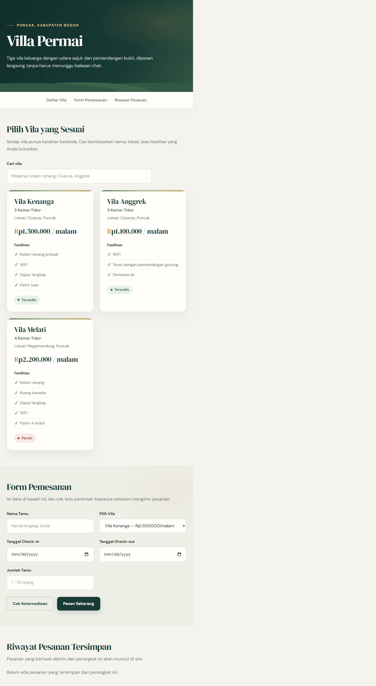
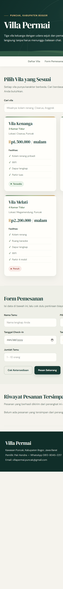

# Villa Permai — Aplikasi Pemesanan Vila

Aplikasi web statis untuk melihat pilihan vila di kawasan Puncak, mencari fasilitas, memperkirakan biaya menginap, dan menyimpan pesanan pada perangkat yang digunakan.

## Identitas

- **Nama:** Maulvi Nazir
- **NIM:** 24011130465
- **Repositori GitHub:** [UTS_MaulviNazir_24011130465_VillaPermai](https://github.com/adeevan2024-m-design/UTS_MaulviNazir_24011130465_VillaPermai)

## Dokumentasi Tampilan

### Tampilan Web



### Tampilan Mobile



## Fitur

- Menampilkan tiga pilihan vila, lokasi, fasilitas, harga per malam, dan status ketersediaan.
- Mencari vila berdasarkan nama, lokasi, atau fasilitas.
- Memeriksa perkiraan harga dan mengirim pesanan melalui formulir.
- Memvalidasi nama tamu, tanggal check-in/check-out, dan jumlah tamu (1–10 orang).
- Menyimpan nama tamu terakhir dan riwayat pesanan secara lokal menggunakan `localStorage`.
- Menyesuaikan tampilan untuk desktop dan perangkat mobile.

## Teknologi

- HTML
- CSS
- JavaScript tanpa framework
- Google Fonts: DM Sans dan DM Serif Display (fallback font digunakan jika font web tidak tersedia)

Aplikasi ini tidak menggunakan server, API, atau basis data. Data vila berada di `script.js`, sedangkan nama dan riwayat pesanan disimpan di browser pada perangkat masing-masing.

## Menjalankan Aplikasi

1. Clone repositori:

   ```bash
   git clone https://github.com/adeevan2024-m-design/UTS_MaulviNazir_24011130465_VillaPermai.git
   ```

2. Buka folder proyek.
3. Buka `index.html` langsung di browser, atau jalankan dengan ekstensi Live Server di Visual Studio Code.

Tidak diperlukan instalasi dependency atau proses build.

## Struktur Proyek

```text
.
├── assets/
│   ├── dokumentasi-mobile.png
│   └── dokumentasi-web.png
├── index.html
├── README.md
├── script.js
└── style.css
```

## Riwayat Commit

| Tanggal | Commit | Ringkasan |
|---|---|---|
| 2026-11-07 | [`386d9d6`](https://github.com/adeevan2024-m-design/UTS_MaulviNazir_24011130465_VillaPermai/commit/386d9d6) | Menambahkan website Villa Permai dan dokumentasinya |
| 2026-11-07 | [`b48cf4f`](https://github.com/adeevan2024-m-design/UTS_MaulviNazir_24011130465_VillaPermai/commit/b48cf4f) | Commit awal |

Lihat [riwayat commit lengkap di GitHub](https://github.com/adeevan2024-m-design/UTS_MaulviNazir_24011130465_VillaPermai/commits/main).

## Perhitungan Harga

Harga dasar dihitung berdasarkan harga vila per malam dikalikan lama menginap. Untuk tamu lebih dari dua orang, dikenakan biaya tambahan Rp100.000 per orang per malam.

## Catatan Penyimpanan

Riwayat pesanan hanya tersimpan di `localStorage` browser yang digunakan dan tidak dikirim ke server. Menghapus data browser dapat menghapus riwayat tersebut.
